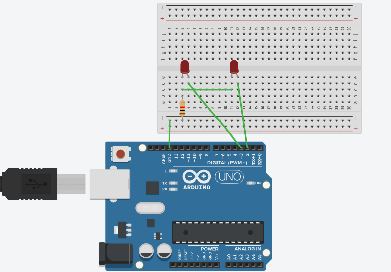
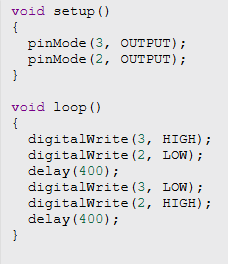
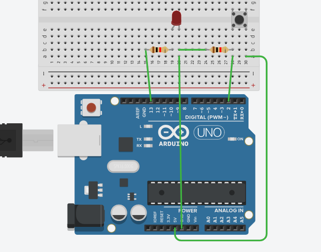
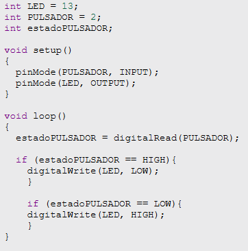
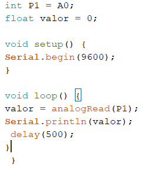
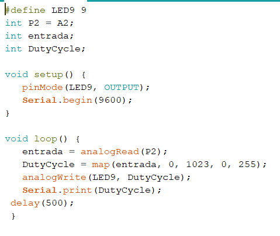
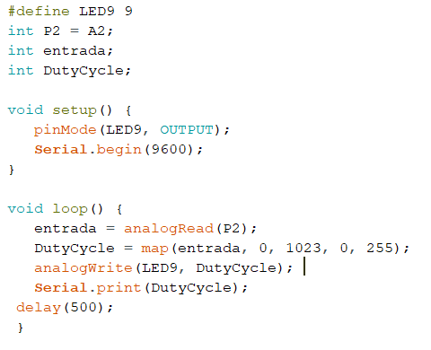

# Reto 1: Encendido alternativo de dos diodos led

Esta practica se dedica a conseguir que **dos diodos led** se **enciendan alternativamente**, uno **encendido** y otro **apagado**, y despues de un tiempo asignado estos dos hagan lo **opuesto**, y asi **sucesivamente.**

[Pincha aquí para ver la prueba en tinkercad](https://www.tinkercad.com/things/jdIYAWvcs1k-grand-elzing-migelo/editel?returnTo=https%3A%2F%2Fwww.tinkercad.com%2Fdashboard)

## Prueba en tinkercad:

El **Arduino** es el **cerebro** del circuito y controla los Leds.

La **Protoboard** sirve para **montar** y **conectar** los componentes sin soldar.

Los **diodos leds** se **encienden** cuando reciben corriente y se apagan cuando no.

La **resistencia limita** la corriente para proteger los Leds.

Los **cables conectan** en el Arduino con los diferentes componentes.

El **cable USB alimenta** el Arduino y permite cargar el programa desde el ordenador.

El **circuito** tiene un **Arduino** conectado a dos **diodos led** mediante cables en una **protoboard**. El programa hace que los dos **diodos led** se enciendan y apaguen alternativamente cada 400 milisegundos.

## Explicación del Código:

El **void setup** es donde se declaran las variables y solo se ejecuta una sola vez. Los **pines 2 y 3** están marcados como output.

El **void loop** es donde se **ejecuta el código**, se repite de forma infinita en un loop.

El **digitalWrite** sirve para enviar una señal de nivel **alto (HIGH)** **o bajo (LOW)** a un pin digital de la placa.

El **pin 3** se **enciende (HIGH)** mientras que el **pin 2** se **apaga (LOW).**

El **delay** hace una **espera** antes de seguir, en este caso la espera es de **400 milisegundos.**

El **pin 3** ahora se **apaga (LOW)**, mientras que el **pin 2** ahora es el que está **encendido (HIGH)**

Otro **delay** de **400 milisegundos**, y el **loop** se **repite.**

# Reto 2 : Pulsador

Este **segundo reto** se trata de un **diodo led** encendido siendo **apagado** al presionar un **pulsador NC (normalmente cerrado)**. 

## Imagen en tinkercad

El pulsador NC (normalmente cerrado) en reposo deja pasar corriente, pero al ser pulsado este lo interrumpe.

**int** son variables cuyos **datos numericos** enteros **sin decimales.**

El **digitalRead** es una función que **lee** el estado de un pin digital. 

El **If** es un **condicional** que permite ejecutar codigo dependiendo si una condición es **verdadera o falsa.**

El codigo lee el estado de **estadoPULSADOR.** Si el estado de **estadoPULSADOR** es **alto (HIGH)**, este apagara el diodo led. Si el estado de estadoPULSADOR es **bajo (LOW)** este se encendera el diodo.

# Reto 3 : Potenciómetro y monitor serie

Este reto se trata de sacar el valor de un **potenciómetro** y revisarlo en el monitor serie.

Un **potenciómetro** es una resistencia variable, en este caso valores entre el numero 0-1023.

Un **float** es un tipo de dato que almacenan numeros **con decimales.**

Un **Serial.begin()** inicia la **comunicación serie** y establecer la velocidad de transmisión en **baudios**.

El **analogRead** es una función que **lee** el estado de un pin de entrada analogico. 

**Serial.PrintIn( )** escribe un mensaje o valor en el **monitor serie.**

En este programa solo se busca el valor del potenciometro, leyendolo con un **analogRead** y asignar ese valor a la variable tipo **float** "valor", y luego escribir este valor en el monitor serie con un **Serial.PrintIn()** cada 500 milisegundos.

# Reto 4 : Mapeado de datos del potenciometro

Ahora con el valor del potenciometro que hemos conseguido anteriormente en el anterior reto vamos a **mapearlo**.

El **mapeo** es una tecnica para transformar un valor numerico en un rango principal a otro rango de forma proporcional. En vez de mandar el valor del potenciometro que hemos sacado principalmente mandamos el valor mapeado al monitor serie.

# Reto 5 : PWN

Finalmente, vamos a hacer que un diodo led se encienda progresivamente asignandole el valor que hemos mapeado anteriormente. El valor mapeado que habiamos declarado previamente era entre el 0 y 255, el rango de luminosidad que podemos ponerle a un diodo led.

Un **#define** es una directiva del preprocesador que se utiliza para crear constantes antes de que el código empiece.

Primero asignamos el pin 9 como "LED9", ya que este será el diodo led que vamos a cambiarle el brillo gracias al **potenciometro.** Despues de integrar las siguientes variables tipo **int** en el **void setup** marcamos LED9 como output.

Hacemos que "entrada" sea el valor que obtengamos de el potenciómetro, cual valor obtenemos con el **analogRead** del "P2". Asignamos que "DutyCycle" obtenga el numero que podemos conseguir mapeando los valores del potenciómetro a un rango de **0 a 255**, el rango que necesita el diodo. Después de hacer esto, con un **analogWrite** le asignamos el valor de "DutyCycle" a el diodo, y tambien escribir el valor en el monitor serie para comprobar si la información es correcta. El loop se va a repetir cada 500 milisegundos gracias a el **delay** que hemos puesto. 

# Reto 6 : Ultrasonido

En esta practica usaremos un sensor ultrasónico, con este, si detecta algo a 15 centímetros o mas cerca del sensor este encenderá un diodo led.

Un **sensor ultrasónico** es un dispositivo que puede medir la distancia que hay entre un objeto hasta el sensor mediante de ondas sonoras que son imposibles de escuchar por su alta frecuencia.

