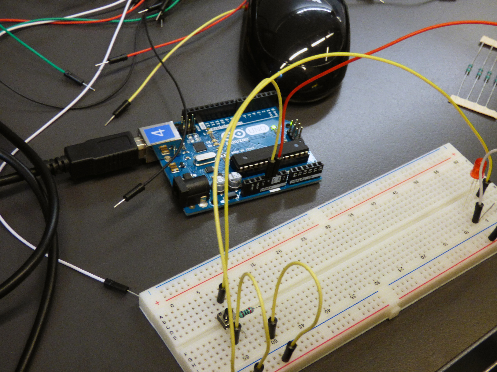

# Cuaderno de Robótica, 4º ESO

Soy Enrique Diego Noguera, tengo 16 años y este es mi cuaderno digital de Robótica de 4º de la ESO. En este repositorio se enseña el progreso en retos, programas y explicaciones que yo realizare en este curso con todo mi esfuerzo y con ayuda de mis compañeros. 

(Imagen por Tomasz_Mikolajczyk en Pixabay
